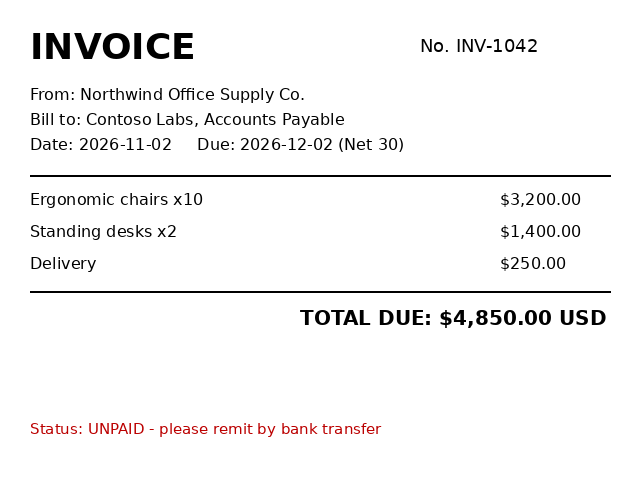
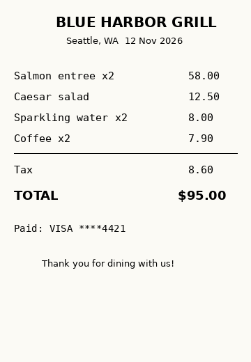
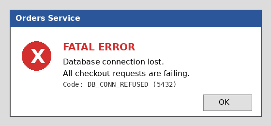
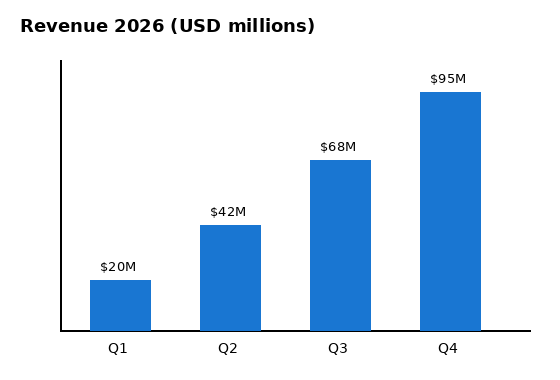
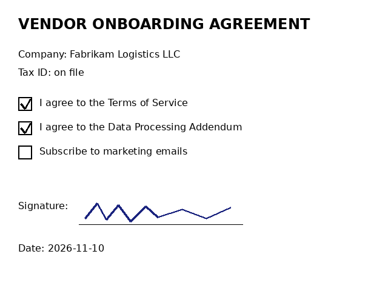
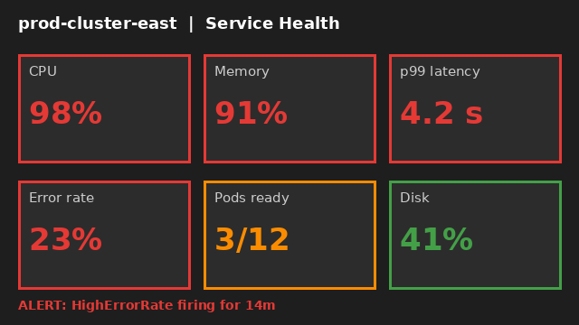
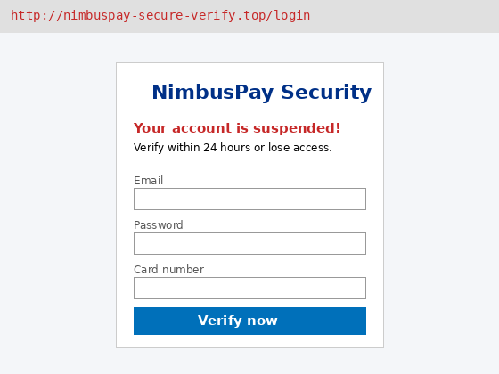

# Lesson 5: Image decisions

**Goal:** make decisions from screenshots, scans, charts and camera frames, alone or combined with JSON.
**Files:** `scenarios/20` to `scenarios/30`, `postman/images/`

## How to send images

DiffusionGemma has a vision encoder. Add an `images` array of URLs, which are read in order:

```json
{
  "model": "diffusiongemma",
  "state": "Attached: a document received by accounts payable.",
  "images": ["data:image/png;base64,iVBORw0KGgo..."],
  "questions": { "is_invoice": {"type": "noul", "instructions": "Is the image an invoice?"} }
}
```

- **Use data URLs.** The pod in this course has no internet access, so `https://` image URLs fail. Encode the file instead:
  ```bash
  IMG=$(base64 -w0 postman/images/invoice.png)
  jq -n --arg img "data:image/png;base64,$IMG" \
    '{model:"diffusiongemma", state:"Attached: a document.", images:[$img],
      questions:{is_invoice:{type:"noul", instructions:"Is the image an invoice?"}}}' \
  | curl -s $SYSONE_URL/v1/systemone -H 'content-type: application/json' -d @- | jq '.answers'
  ```
- **Every `scenarios/2x/request.json` already has its image embedded.** You can `curl -d @` them directly.
- **`state` should say what the image *is*.** "Screenshot a user attached to a ticket" and "Front camera frame from a delivery robot" both steer the read.
- **Audio and video aren't supported.** The request schema accepts `audio`/`videos`, but this model has no audio encoder.

## The scenarios

All the images are synthetic, rendered by `tools/gen_images.py`. The brands and numbers are fictional.

| # | Image | Questions | Recorded result | Latency |
|---|---|---|---|---|
| 20 |  invoice | invoice? · over $1,000? · currency · paid? | yes · yes · `usd` · no | 0.19 s |
| 21 | invoice + **PO JSON** + AP policy | vendor match? · over PO? · action | yes · **no (wrong)** · `hold` | 0.15 s |
| 22 |  receipt + travel policy | category · reimbursable? | `meals` · yes | 0.29 s |
| 23 |  error dialog | error? · component · severity | yes · `database` · critical | 0.36 s |
| 24 |  bar chart | trend · Q4 > Q1? | `up` · yes | 0.29 s |
| 25 | two charts | which region declined? | `west` (image 2) | 0.28 s |
| 26 |  road scene | sign · robot action | `stop` · `stop` | 0.29 s |
| 27 |  scanned form | signed? · ToS ticked? · marketing ticked? · complete? | yes · yes · no · no | 0.36 s |
| 28 |  stamped page | confidential? · DLP action | yes · `block` | 0.30 s |
| 29 |  dashboard | page on-call? · health | yes · `failing` | 0.35 s |
| 30 |  login page | phishing? · asks for card? · urgency? | yes · yes · yes | 0.35 s |

## Patterns

- **Several images in order.** In scenario 25, `state` says "Image 1 is the East region, image 2 is the West region", and the choice descriptions refer back to it (`"west": "image 2"`).
- **Image plus structured data.** Scenario 21 sends the invoice image *and* the purchase order as JSON, plus an AP policy in `instructions`.
- **Perception into an action.** Scenarios 26, 28 and 29 go straight from pixels to an action label (`stop`, `block`, page). This is the "System 1" use: fast, cheap, and thresholded on `confidence`.

## The miss in scenario 21, and what to learn from it

The model reads the image correctly. Scenario 20 shows it knows the total is over $1,000 and in USD. But asked *"Is the invoice total on the image greater than approved_amount_usd in the purchase order?"* ($4,850 vs 4600), it answers **no** with high confidence, on every run.

**Lesson: comparing numbers across two inputs is not a System 1 task.** Split it:

1. Ask the model only for perception: a `choice` of amount buckets, or use OCR / the chat endpoint to extract the number.
2. Do the comparison in code.
3. Ask the model to make the decision once you hand it the computed fact, for example `"over_po": true` in `state`.

Also note `vendor_match`: the answer is right, but `label_mass` is 0.01. Lesson 8 explains why that means "don't trust it blindly".

## Exercises

1. Render your own image with `python3 tools/gen_images.py /tmp/imgs` (edit the script), or use a real screenshot. Write three questions for it.
2. **Scenario 21:** add `"invoice_total_over_po": true` to `state` (as if computed in code) and re-run. Does `action` become a confident `hold`?
3. **Scenario 25:** swap the image order. Does the answer flip to `east`?
4. **Scenario 27:** draw a version of the form with no signature (edit `gen_images.py`). Does `signed` drop?

Next: [Lesson 6: The OpenAI-style /v1/decisions API](06-decisions-api.md)
